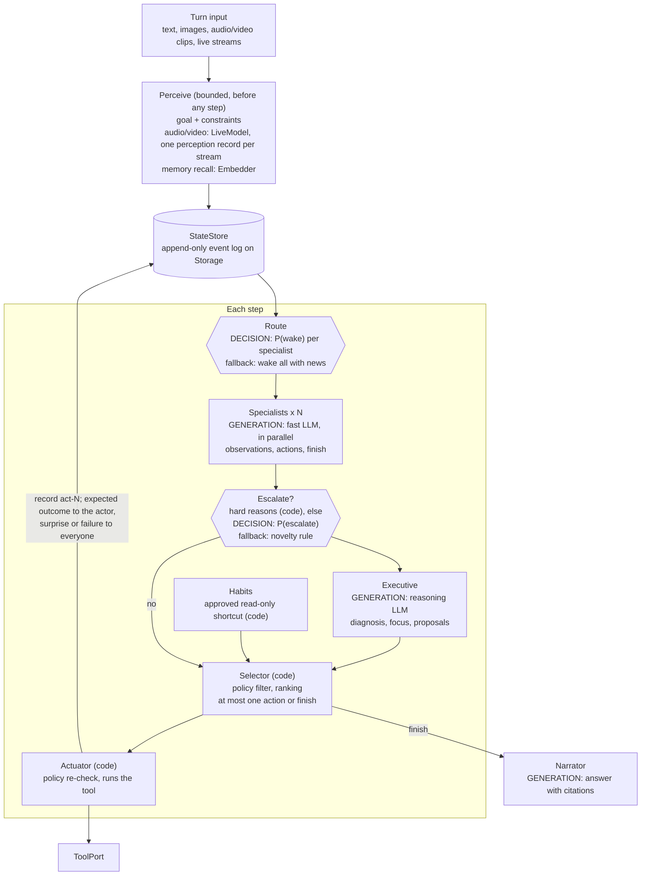

# brain

A small, readable TypeScript proof of concept for an LLM agent harness built
from brain-inspired parts. Several narrow specialists on a fast model propose
what to do next. A reasoning model (the executive) is consulted only when
needed. An optional decision model makes quick routing calls with typed
probabilities. A single policy-checked actuator runs every tool call.

This is a proof of concept, not a framework. The brain vocabulary is a loose
engineering metaphor.

## What it does, and why

You give the harness a goal: text, images, recorded audio or video clips, or a
live audio/video stream. It works on the goal in bounded steps until it can
answer, or until a step, budget or stall limit stops it.

The design aims for:

- **Low cost.** Most model calls go to a small fast model. The reasoning model
  runs only on surprises, conflicts, stalls, media only it can see, or when a
  judgment says it is needed. Approved read-only habits run with no model call.
- **Prompt-cache-friendly prompts.** Every agent keeps one append-only
  transcript. All agents share a byte-identical leading system block. New
  information is appended as deltas, and the transcript is rebuilt
  (compacted) only just before it would overflow, or when the provider says
  its cache has expired.
- **Safety by construction.** Models only *propose*. Hard policy (read-only
  mode, denied tools, allowed effects, argument validation) is checked in code
  by the selector and checked again by the actuator, the only component that
  runs tools. Probabilities from the decision model never affect policy.
- **Evidence you can check.** Every tool output is stored in full as a record
  (`act-N`). Agents see short previews and can read any record in full. A
  "verified" answer must cite a successful record.
- **No vendor lock-in.** LLMs, decision models, embeddings, live media models,
  storage and tools all sit behind small interfaces. The core imports no SDK.

## Generation versus decisions

The harness uses two different kinds of model for two different jobs.

- **Generative LLMs** (`LlmClient`) write text: specialists' proposals, the
  executive's diagnosis and plan, the narrator's answer. Each agent's model is
  set by its profile: `fast` for specialists and the narrator, `reasoning`
  for the executive.
- **A decision model** (`DecisionModel`, optional) writes no text. It reads a
  state and answers predefined questions with typed results: a yes/no
  probability, one of a set of options, or a score on a scale. This is the
  kind of model TypeSafe calls a *System One* model. The harness asks it two
  things:
  1. **Routing:** for each specialist with something new to look at, *should
     it wake now?* (`P(yes) >= wakeThreshold` wakes it.)
  2. **Escalation:** when there is no hard reason to escalate, *should the
     executive think about this first?* (`P(yes) >= escalateThreshold`
     consults it.)

  Without a decision model, or when an answer is missing, malformed or the
  call fails, the harness uses deterministic rules: wake every specialist
  with relevant news, and escalate on "novelty" when the first step produced
  nothing.



Hexagons are decisions (typed probabilities, no text). Boxes marked
GENERATION are LLM calls. Everything else is deterministic code.

## Setup

Requires [Bun](https://bun.sh).

```sh
bun install
bun run check    # strict typecheck + all tests (no network)
```

### Interactive chat example

`examples/chat.ts` talks to any OpenAI-compatible chat completions API. It
uses real read-only tools scoped to the current directory (`current_time`,
`list_files`, `read_file`) and stores sessions and memory in `.brain-data/`.

```sh
OPENAI_BASE_URL=https://api.openai.com/v1 \
OPENAI_API_KEY=sk-... \
FAST_MODEL=<small fast model> \
REASONING_MODEL=<reasoning model> \
bun run chat
```

| Variable | Required | Meaning |
| --- | --- | --- |
| `OPENAI_BASE_URL` | yes | API base URL, including `/v1` if your provider uses it |
| `OPENAI_API_KEY` | yes | Bearer token |
| `FAST_MODEL` | yes | Model for the specialists and the narrator |
| `REASONING_MODEL` | yes | Model for the executive and offline consolidation |
| `EMBEDDING_MODEL` | no | Enables memory recall by cosine similarity |
| `VISION` | no | `reasoning` or `all`: which profiles accept images (default: none) |
| `SEND_REASONING_EFFORT` | no | `1` sends `reasoning_effort` (only for models that accept it) |
| `FAST_SERVICE_MODE` | no | `standard` (default), `fast` or `ultrafast` lane for the fast profile |
| `SERVICE_TIER_FAST` | no | Provider `service_tier` value for the `fast` lane, if it has one |
| `SERVICE_TIER_ULTRAFAST` | no | Provider `service_tier` value for the `ultrafast` lane, if it has one |
| `CONTEXT_WINDOW` | no | Context window of both models in tokens (default 128000) |
| `BRAIN_DATA` | no | Storage directory (default `.brain-data`) |

Chat commands: `/image <path>` attaches an image to the next message, `/new`
starts a new task, `/sleep` consolidates past episodes into knowledge, `/quit`
exits. The example runs without a decision model or a live media model,
because no adapters for them ship with this project.

## Using it in code

```ts
import { Harness, FunctionTools, type ModelProfile, type DecisionModel, type LiveModel, type MediaPart } from "./src/index.ts";
import { OpenAICompatibleLlm } from "./src/adapters/openai-compatible.ts";
import { FileStorage } from "./src/adapters/file-storage.ts";

const fast: ModelProfile = { id: "fast", model: "my-small-model", tier: "fast", reasoningEffort: "none", serviceMode: "standard", contextWindow: 128_000, maxOutputTokens: 1_000 };
const reasoning: ModelProfile = { id: "reasoning", model: "my-reasoning-model", tier: "reasoning", reasoningEffort: "medium", serviceMode: "standard", contextWindow: 128_000, maxOutputTokens: 4_000 };

declare const decisionModel: DecisionModel;          // your adapter, optional
declare const liveModel: LiveModel;                  // your adapter, needed only for audio/video
declare const microphone: AsyncIterable<MediaPart>;  // e.g. audio chunks until the user stops talking

const harness = new Harness({
  llm: new OpenAICompatibleLlm({ baseUrl: "https://api.example.com/v1", apiKey: "..." }),
  profiles: { fast, reasoning },
  tools: [{ name: "get_status", description: "Current status of a service", effect: "read", params: { service: { type: "string", description: "service name" } } }],
  toolPort: new FunctionTools({ get_status: (args) => `ok: ${String(args.service)}` }),
  specialists: [{ name: "ops", instructions: "Check service status and answer status questions.", tools: ["get_status"], canFinish: true }],
  storage: new FileStorage(".brain-data"),
  decisions: { model: decisionModel, wakeThreshold: 0.5, escalateThreshold: 0.6 },
  live: liveModel,
});

const session = await harness.openSession("support-chat");
const result = await session.turn({ input: "Is the billing service up?" });
console.log(result.status, result.completion, result.answer.text);

// Live audio: the stream is read during perception, then the steps run.
await session.turn({ input: "Listen to this", live: [{ medium: "audio", mimeType: "audio/pcm", chunks: microphone }] });
```

`RunResult` also returns the trace, every model call with its profile, every
decision request with its typed answers, the actions taken, token usage, and
the session's state.

## Architecture and source guide

One turn (`src/session.ts`) reads top to bottom: **perceive**, then each
step: **habits, route + specialists, escalate, select, act/route the outcome
or finish**, then **wrap up** (narrate and store the episode). Each part is a
small named method.

| Path | What it holds |
| --- | --- |
| `src/io/content.ts` | Content parts: `text`, `image`, `audio`, `video` |
| `src/io/llm.ts` | `LlmClient` port, `ModelProfile` (tier, reasoning effort, service lane), `chooseProfile`, `withUrgency` |
| `src/io/decision.ts` | `DecisionModel` port, typed questions and answers, `checkDecisions` |
| `src/io/live.ts` | `LiveModel` port, `LiveInput` streams, bounded `takeObservations` |
| `src/io/embeddings.ts`, `src/io/storage.ts` | `Embedder` port and cosine similarity; async `Storage` port and `MemoryStorage` |
| `src/adapters/` | `OpenAICompatibleLlm`, `OpenAICompatibleEmbedder` (plain `fetch`), `FileStorage` (`node:fs`) |
| `src/session.ts` | The turn loop |
| `src/harness.ts` | Configuration, defaults, shared services, `openSession()` / `run()` |
| `src/state.ts` | Event log fold, snapshot with evidence index, event rendering |
| `src/transcript.ts` | Append-only per-agent transcripts and compaction |
| `src/agents.ts` | Shared and role prompts, `Agent` |
| `src/validate.ts` | Validation of model output into proposals |
| `src/selector.ts` | Policy filter and ranking |
| `src/tools.ts` | `ToolSpec`, `ToolPort`, `FunctionTools`, policy checks, `Actuator` |
| `src/monitor.ts` | Surprise detection, escalation reasons, stall detection |
| `src/memory.ts` | Episodic, knowledge and habit stores |
| `src/narrator.ts` | Final answer with citation checks |
| `src/consolidation.ts`, `src/background.ts` | Offline consolidation into knowledge and pending habits; idle idea generation (never runs tools) |
| `examples/chat.ts` | Interactive chat over a real provider |
| `test/` | Tests; `test/fixtures/` holds the only scripted test doubles |

### Models, roles and service lanes

- A `ModelProfile` has three independent settings: `tier` (`fast` or
  `reasoning`), `reasoningEffort`, and `serviceMode`, the provider latency
  lane (`standard`, `fast` or `ultrafast`).
- `chooseProfile(profiles, role)` is the single place that maps roles to
  profiles. An agent keeps its profile for life, so its transcript never
  changes model.
- `urgency: "high"` only raises a `standard` lane to `fast`. It never changes
  the model, tier or effort, and never downgrades `ultrafast`.
- The OpenAI-compatible adapter sends a `service_tier` value only for lanes
  you configure (`serviceTiers: { fast, ultrafast }`). An unconfigured lane is
  sent as the provider default.

### Prompts and caching

- **System prompt order:** first a shared block (rules, tools sorted by name,
  reply schema), identical for every agent, then the agent's role block.
- **Append-only transcripts:** each call appends one user message with the
  events this agent may see since its last call, plus private notes. Earlier
  messages are never rewritten.
- **Compaction** starts a new epoch with a fresh state snapshot and a short
  tail of the agent's own replies. No summarizing model call is made. It
  happens just before the next request (plus its output reserve) would
  overflow, or when the provider returns a `cacheExpiresAt` hint that has
  passed and the transcript is large. No cache lifetime is assumed, and a
  cache hit is never guaranteed.
- **Atomic:** if even a fresh snapshot does not fit, `ContextBudgetError` is
  thrown and the transcript is left unchanged.
- **Sessions:** transcripts carry across a session's turns, so a new message
  is just another delta. `newTask: true` clears the workspace and constraints
  and starts fresh epochs. A session reopened from storage rebuilds its state
  from the event log.

### Evidence, completion and arbitration

- Tool outputs are stored in full as records (`act-N`); audio/video
  observations as perception records (`per-N`). Agents see previews and can
  propose `{"kind":"read_record","id":"act-N","offset":0}` to receive a chunk
  privately on their next turn.
- Every snapshot carries an evidence index (id, call, size, preview), so
  records stay reachable after compaction. The index is global: an agent can
  see that a record routed to someone else exists.
- A finish is **verified** if it cites a successful action record, and
  **answer-only** otherwise (for example a direct question that needs no
  tools). A finish citing unknown ids is rejected. Perceptions never make a
  finish verified.
- The selector ranks candidates by origin (executive > habit > specialist),
  then kind (verified finish > read > write > answer-only finish), then
  support from distinct model profiles. A tie involving a write holds and
  escalates as a conflict. At most one action or finish is released per step.
- Verified finishes are narrated with citation checks. Answer-only finishes
  are returned as written (`grounded: false`).

### Repeats, outcome routing and stalls

- An identical read may run again after a write, or in a new turn. An
  identical write runs at most once per turn.
- An expected outcome of a specialist's action goes only to the specialists
  who proposed it. Surprises, failures, and executive or habit actions go to
  everyone and enter the workspace.
- Progress means an action, a delivered record, executive focus, a new
  outcome, or a goal or constraint change. Rephrased observations do not
  count. A stuck turn stops after `stallSteps` idle steps once the executive
  has been consulted.

### Images, audio and video

- Images go only to profiles with `vision: true`. If only the reasoning
  profile has vision, the executive is consulted before any action is
  released, and text-only specialists are told the media is not visible to
  them. If the executive cannot look (no executive calls allowed, not enough
  model-call budget, or its call fails until the cap), no action is released.
- Audio and video never go to chat models. They go to an injected
  `LiveModel`, which reads an `AsyncIterable` of media chunks and yields text
  observations. A recorded clip in `input` becomes a one-chunk stream; live
  sources are passed as `live: [{ medium, mimeType, chunks }]`.
- **Perception is a bounded phase before the steps start**, not concurrent
  real-time cognition. Each stream is read until the caller ends it or until
  `limits.maxLiveObservations` observations; the model's stream is then
  closed, so a well-behaved `LiveModel` stops reading input. Aborting the
  turn's `signal` ends it as `cancelled` even if the source is waiting for
  more input. Each stream becomes one perception record, and the workspace
  gets one pointer to it.
- Media the configuration cannot handle is rejected up front with
  `UnsupportedContentError`. Adapters reject it too.

### Memory and persistence

- `EpisodicStore`, `KnowledgeStore` (with provenance) and `HabitStore` are
  async and live on `Storage`, as does each session's event log.
- Recall needs an `Embedder`: items are embedded when written and ranked by
  cosine similarity (`recall.minSimilarity` depends on the embedding model).
  Without an embedder nothing is recalled. Recalled items enter as unverified
  claims.
- Habits fire on an exact, case-insensitive trigger phrase in the goal. They
  come from offline consolidation as pending and need approval
  (`autoApproveReadOnlyHabits` is off by default). A surprising outcome
  suspends a habit.

## Implemented versus injected

| Kind | Pieces |
| --- | --- |
| **Ports you implement or inject** | `LlmClient`, `DecisionModel`, `LiveModel`, `Embedder`, `Storage`, `ToolPort` |
| **Real implementations included** | Turn loop, selector, actuator and policy checks, monitor, transcripts, event log, memory stores, consolidation, idle ideas, `MemoryStorage`, `FunctionTools` |
| **Real adapters included** | `OpenAICompatibleLlm` and `OpenAICompatibleEmbedder` (plain `fetch`), `FileStorage` (JSON files and JSON-lines logs) |
| **Not included** | No `DecisionModel` adapter (no TypeSafe/Jev or other decision-model integration). No `LiveModel` adapter. Without them, routing is deterministic and audio/video input is rejected. |
| **Test-only doubles** (`test/fixtures/`) | `ScriptedLlm`, `ScriptedDecisions`, `WordHashEmbedder`, a fictional incident scenario, inline `LiveModel` doubles. None are exported from `src/`. |

## Limitations

- **Nothing has run against a live provider.** The OpenAI-compatible adapter
  is tested only through an injected `fetch`, and `examples/chat.ts` has not
  been run in CI. No decision model or live media model has been exercised;
  all tests use scripted doubles. There are no benchmarks, so claims about
  cost or quality are design intent, not measurements.
- Decision requests (at most two per step) are not counted against
  `maxModelCalls`. Their probabilities are used as given; calibration depends
  on the model you inject.
- The decision model sees the full state snapshot and recent events,
  including outcomes routed privately to one specialist.
- A `LiveModel` that ignores its abort signal can keep waiting on a stalled
  source after the turn has been cancelled.
- Token counts use a rough estimator (`characters / 4`) unless you inject a
  tokenizer; images use a flat estimate.
- `StateStore.apply` updates the in-memory view before the storage write
  finishes. If the write fails, the turn throws and a reopened session will
  not contain that event. `FileStorage` assumes a single process.
- Not included: vector index or forgetting, provider-native structured
  output, long-running tools, full-duplex real-time speech.

## Tests

`bun run check` runs the strict typecheck and every test, with no network.

| Behavior | Test file |
| --- | --- |
| Typed decision answers; invalid or missing answers dropped; routing skips specialists; escalation by judgment; fallbacks; hard reasons and policy ignore probabilities | `decisions.test.ts` |
| Shared prompt prefix byte-identical across agents, role last | `session.test.ts` |
| Append-only deltas, overflow and cache-expiry compaction, evidence index kept, atomic failure and recovery | `transcript.test.ts` |
| Expected outcomes to the actor only, surprises broadcast; `read_record` chunks across compaction | `session.test.ts` |
| Answer-only completion and finish arbitration | `session.test.ts`, `selector.test.ts` |
| Repeat rules; sessions across turns; stall detection | `session.test.ts`, `harness.test.ts` |
| No media reaches an incapable model; executive sees images before any action; budget and failure cases | `session.test.ts`, `adapters.test.ts` |
| Audio clip through a `LiveModel`; live source read lazily, closed at the bound; cancellation while a source waits | `session.test.ts` |
| Service lanes, `ultrafast` kept under urgency, adapter maps only configured lanes | `harness.test.ts`, `adapters.test.ts` |
| File storage round trip; session and memory survive a restart | `adapters.test.ts` |
| Embedding recall by cosine similarity; none without an embedder | `memory.test.ts` |
| Policy gate, reflex habits, budgets, cancellation, end-to-end scenario | `harness.test.ts` |
