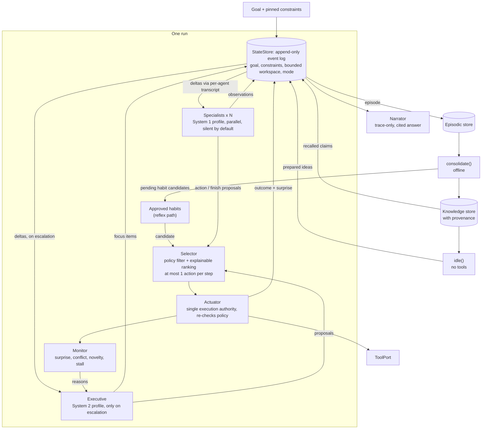

# brain

An LLM harness structured around brain-inspired patterns: many cheap, narrow
processes propose; a small shared workspace and one gate decide what happens.

This repository is a **readable TypeScript proof of concept**, not a framework.
The "brain" vocabulary is used as loose engineering metaphor only — nothing here
claims to model neuroscience. Everything runs on scripted fake models and
in-memory stores, so the tests and demo are deterministic.

```sh
bun install
bun run typecheck   # tsc --noEmit, strict
bun test            # unit + end-to-end tests
bun run demo        # deterministic walkthrough with a full trace
```

## Architecture



### One step of the loop (`src/harness.ts`)

1. **Reflex:** approved habits whose trigger matches the goal propose their call. If exactly
   one is eligible, its tool is read-only and allowed by policy, and the monitor has nothing
   pending (no surprise/stall, not in post-error caution), it runs immediately and the step
   makes **no model calls**. Otherwise habits are just high-ranked candidates in step 4.
2. **System 1:** specialists with *new events from someone else* are woken and called
   in parallel on the cheap profile. Each returns zero or more validated proposals.
   Observations go through the workspace admission gate; actions/finish become candidates.
3. **Monitor:** escalates to the executive (System 2 profile) only for novelty (nothing
   proposed on step 1), conflict (tied candidates where one writes), surprise (last
   outcome contradicted its prediction) or a stall. The executive mostly steers by
   adding high-priority `focus` items, and may propose an action or finish.
4. **Select:** hard policy filter first (unknown tool, deployment permissions, pinned
   constraints, schema check), then a lexicographic, explainable ranking:
   `origin (executive > habit > specialist) → reads before writes → distinct-profile support`.
   Finish is accepted only if it cites at least one successful action.
5. **Act:** the actuator re-checks policy, runs the tool, records prediction vs. actual,
   and broadcasts the outcome as a delta. Errors are logged as failed outcomes.
6. **Terminate** on finish, `maxSteps`, model-call budget, cancellation (`AbortSignal`),
   or no progress after the executive has already been consulted. One model call is
   always held back so the narrator fits inside `maxModelCalls`. Cancellation is checked
   after model calls and again inside the actuator immediately before a tool runs.

## Prompt-prefix stability and compaction (`src/transcript.ts`)

Every agent keeps its **own append-only transcript** for the run:

```
[system: role + tool schemas + output contract]   immutable
[user:  EPOCH n · state snapshot · request]         start of epoch
[assistant: reply]
[user:  UPDATES since seq k (deltas only) · request] appended each call
[assistant: reply]  ...
```

- Earlier messages are never rewritten, so each request extends the previous one
  byte-for-byte. `LlmRequest.stablePrefixLength` tells an adapter where the reused
  prefix ends so it *may* place a cache breakpoint.
- Changes to goal, constraints, workspace and mode are deltas in the event log and
  reach each agent as appended `UPDATES` lines; nothing edits the snapshot.
- Before a request would exceed `contextWindow − maxOutputTokens`, the transcript
  starts a new epoch: it **deliberately rebuilds** the prefix from the *current*
  authoritative state (all deltas folded in; pinned constraints always included),
  plus a short, clearly-labelled tail of the agent's own last replies. A stale
  snapshot is never treated as authoritative over newer deltas.
- Token counting is an injectable `TokenEstimator` (default: `chars / 4`).

**Caching is provider-dependent.** Stable prefixes make prompt caching *possible*;
whether a provider serves a hit depends on its own rules (minimum lengths, TTLs,
breakpoints, routing). The `ScriptedLlm` reports a *simulated* shared-prefix token
count, which is an upper bound, not a measurement.

## Model routing

`ModelProfile` separates three things that are often conflated:

| Field | Meaning |
|---|---|
| `tier` | `system1` (cheap/narrow) or `system2` (deliberate reasoning) |
| `reasoningEffort` | thinking budget for that model |
| `serviceMode` | provider latency lane (`standard` / `fast`); does not change capability |

Specialists use `profiles.system1`; the executive uses `profiles.system2` and is
called only on escalation. High urgency switches only `serviceMode` to `fast`.
No provider SDK is included: implement `LlmClient.complete()` to adapt one.

## Safety properties the code enforces

- **One execution authority.** Only `Actuator.execute` calls a `ToolPort`; agents
  return proposals. Tool effects (`read`/`write`) come from the trusted registry —
  any effect a model claims is ignored.
- **Policy cannot be bypassed** by specialists, the executive or habits: the selector
  filters and the actuator re-checks pinned constraints, deployment permissions and
  argument schemas.
- **Validated LLM boundary.** Model output is parsed with small hand-written validators
  (`src/validate.ts`); invalid entries are dropped and reported, never cast.
- **No uncalibrated precision.** Confidence and priority are ordinal labels; selection
  is a ranking with a plain-English reason. Agreement among agents on the *same model
  profile* counts as one vote, since those samples are correlated. Different profiles
  are not necessarily statistically independent either; this is a tie-breaker, not
  a calibrated confidence estimate.
- **Bounded work.** Specialists wake only on new events from others, so silence ends
  the cascade; proposals per reply, steps, model calls and executive calls are capped.
- **Citation checks.** The narrator is instructed to answer from the recorded trace;
  the runtime checks citation IDs (`[act-2]`) against actual actions and workspace
  entries. Arbitrary evidence pointers in a model's observation do not become valid
  citations. The `grounded` flag means IDs are present and valid, **not** that the
  evidence entails every claim. Workspace entries themselves can be unverified claims.

## Memory

- **Episodic store** — every run is appended as an episode (actions, predictions,
  outcomes, answer).
- **Knowledge store** — written only by `consolidate()`, and every item must cite the
  episodes it came from. Recalled knowledge enters the workspace as an *unverified
  claim* with its provenance ids.
- **Habits** — registered as `pending`; a human calls `approve()`. A surprising outcome
  suspends the habit. Habit calls go through the same policy gate as everything else.
- **`consolidate()`** — explicit offline pass: replays unconsolidated episodes (most
  surprising first), accepts only lessons/habits citing replayed episodes, rejects the rest.
- **`idle()`** — bounded background reflection with no tool port and actions rejected at
  validation; produces ideas a later run can admit at low priority.

## Layout

| File | Purpose |
|---|---|
| `src/types.ts` | Domain types (deltas, proposals, records, episodes) |
| `src/llm.ts` | `LlmClient` port, `ModelProfile`, token estimator, `ScriptedLlm` |
| `src/state.ts` | Event-log port, `StateStore`, workspace admission, rendering |
| `src/transcript.ts` | Per-agent append-only transcript, epochs and compaction |
| `src/validate.ts` | Runtime validation of model output |
| `src/agents.ts` | Prompt construction (tool schemas + output contract), `Agent` |
| `src/tools.ts` | Tool registry types, `ToolPort`, policy gate, `Actuator` |
| `src/selector.ts` | Candidate merging and explainable selection |
| `src/monitor.ts` | Surprise detection, escalation reasons, stall detection |
| `src/memory.ts` | Episodic / knowledge / habit ports + in-memory stores |
| `src/narrator.ts` | Trace-grounded answer with citation checking |
| `src/harness.ts` | The run loop |
| `src/consolidation.ts`, `src/background.ts` | Offline consolidation, idle ideas |
| `examples/` | Fictional "nightly export failed" scenario and demo |

## Implemented vs. deferred

Implemented: everything above, exercised by tests and the demo with scripted models.

Deferred / known limitations:

- **No real provider adapters, no quality or cost benchmarks.** Nothing here shows the
  architecture beats a single-loop agent; that needs real models and matched tasks.
- **In-memory only.** Event log, episodes, knowledge and habits have ports but no
  persistent implementations; there is no concurrency control across runs.
- **Simple heuristics.** Keyword-overlap recall (no embeddings), binary/substring
  surprise, fixed lexicographic ranking, and a deterministic compaction tail (no
  model-written summary).
- **No learning of weights.** No specialist reliability scores, credit assignment or
  automatic habit promotion; habits need manual approval.
- **One action per step**, no parallel tool execution, no sub-swarms, no distributed
  scheduling, no streaming.
- **Soft `instruction` constraints** are shown to every agent but not machine-enforced;
  only `read_only`, `deny_tool` and deployment permissions are hard gates.
- Retries, rate limiting and partial tool results are not handled.
