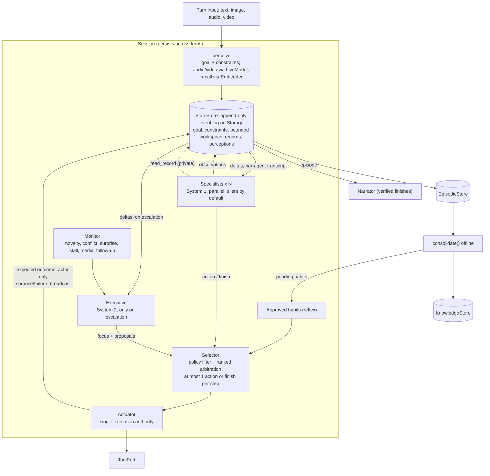

# brain

An LLM harness built on brain-inspired patterns: many cheap, narrow processes
propose; a small shared workspace and one gate decide what happens.

This is a **readable TypeScript proof of concept**, not a framework. The
"brain" words are a loose engineering metaphor. It merges the two earlier PoCs
(PR #1 and PR #2): PR #2's bounded loop is the base, and PR #1's IO ports,
storage, adapter and session ideas are added on top.

```sh
bun install
bun run check      # strict typecheck + tests (scripted test fixtures; no network)
bun run chat       # real chat over an OpenAI-compatible API (see examples/chat.ts)
```

## What is real, what is a port, what is untested

| Kind | Pieces |
| --- | --- |
| **Ports** (interfaces, `src/io/`) | `LlmClient`, `Embedder`, `LiveModel` (audio/video), `Storage` (async key-value + append-only logs), `ToolPort`, content parts (`text`, `image`, `audio`, `video`) |
| **Real implementations** in the core | `MemoryStorage` (in-process storage), `FunctionTools` (sends tool calls to plain functions), `Actuator`, selector, monitor, transcripts, event log, memory stores, consolidation, idle reflection |
| **Real adapters** (`src/adapters/`) | `FileStorage` (JSON files + JSON-lines logs; tested on a real temp directory); `OpenAICompatibleLlm` / `OpenAICompatibleEmbedder` (plain `fetch`, no SDK) |
| **Not tested live** | The OpenAI-compatible adapter has **never been run against a live endpoint**. Tests only check request/response mapping through an injected `fetch`. `examples/chat.ts` has not been run in CI. No live provider calls were made during development. |
| **Missing on purpose** | No concrete `LiveModel` adapter ships. Audio/video input is rejected unless you inject one. Nothing fakes it. |
| **Test-only fixtures** (`test/fixtures/`) | `ScriptedLlm` (replies from a script; simulated cache counts), `WordHashEmbedder` (hashed bag of words), the fictional export-incident scenario, an inline `LiveModel` double. None of these are exported from `src/`. |

## Architecture



One turn (`src/session.ts`) reads top to bottom:
**perceive, then each step: habits, then specialists, then escalate, then select, then act/route or finish.**
Each step is a small named method.

## Design

### Provider-neutral IO
- No SDK in the core. The LLM, embeddings, live media, storage and tools all sit behind small interfaces in `src/io/` and `src/tools.ts`.
- Messages carry content parts. A model profile declares `vision: true` if it can take images. Audio/video never go to chat models: the `LiveModel` port turns them into text observations.
- The harness rejects media up front when no configured model can handle it. Adapters reject it too, through `assertContentSupported`. Such errors are thrown, not hidden as empty replies.
- **Images and System 1.** If only the System 2 profile has vision, images go only to the executive, and the monitor escalates (`media`) before any action runs. Text-only specialists are told the media is not visible to them. If the executive cannot look, nothing blind is released: `maxExecutiveCalls: 0` is rejected up front as a configuration error; a model-call budget too small for the specialists plus the executive (one call is reserved for it) ends the turn as `budget_exhausted` before any action; a failed executive call holds all actions and retries within the executive cap, then ends as `budget_exhausted`.
- **Audio/video.** One input becomes one bounded **perception record** (`per-N`). Agents can cite it and read it in full through `read_record`, and the workspace gets one pointer to it. Perception is never treated as *verified* evidence.

### Stable prompt prefixes (caching)
- **System prompt order:** first a SHARED block (rules, tools sorted by name, reply schema), then the agent's ROLE block. Every agent built from the same tool registry has byte-identical leading text.
- **Append-only transcripts.** Each agent's transcript only grows. Every call appends one user message with the *events this agent may see* since its last call, plus private notes. Earlier messages are never rewritten.
- **Compaction** starts a new epoch, holding a fresh snapshot of the current state plus a short tail of the agent's own replies. No summarizing model call is made. It happens:
  - just before the next request (including the output reserve) would overflow the context window; or
  - when a provider-supplied `cacheExpiresAt` hint says the cached prefix has expired *and* the transcript is big. That is a cost optimization, never "free". No TTL is assumed.
- **Atomic.** If even a fresh snapshot does not fit, `prepare` throws `ContextBudgetError` and leaves the transcript unchanged.
- **Fixed models.** An agent never switches model mid-transcript. Urgency only changes the provider service lane (`withUrgency`).
- **Sessions.** Transcripts persist across the turns of a session, so a new goal is just another delta. `newTask: true` is an explicit boundary: it clears the workspace and constraints and opens fresh epochs. A session reopened from storage rebuilds its state from the event log, and its agents start with a fresh snapshot.

### System 1 / System 2
- **System 1:** specialists and the narrator use the cheap `system1` profile. Approved read-only habits can run with no model call at all.
- **System 2:** the `system2` executive is consulted only when the monitor flags novelty, conflict, surprise, a stall, images only it can see, or a record it asked for. It is capped per turn (`maxExecutiveCalls`).
- **Role-to-model mapping:** `chooseProfile(profiles, role)` is the single place that decides which profile each role uses.

### Evidence
- **Records by ID.** Every tool output is stored in full in its action record (`act-N`), inside the event log.
- **Previews.** Agents see short previews with a `[cut; read_record act-N]` pointer.
- **`read_record`.** An agent proposes `{"kind":"read_record","id":"act-N","offset":0}`. The chunk is delivered **privately** to that agent on its next turn. No arbitration is needed, since reading has no side effects.
- **Evidence index.** Every snapshot includes an index of records (id, call, size, short preview), so evidence stays reachable after compaction. The index is global on purpose: agents can see that a record routed to someone else exists, and read it if they need it.

### Completion and arbitration
- **Two kinds of finish.**
  - *verified*: cites at least one successful action record.
  - *answer-only*: `evidence: []`, or citing only workspace items or perceptions. Fine for questions that need no tools.
- **Rejection.** A finish that cites unknown IDs is rejected.
- **Finish competes in normal ranking**, by (origin, kind, independent support):
  - origin: executive > habit > specialist
  - kind: verified finish > read > write > answer-only finish

  So an executive action beats a specialist's finish, and an answer-only reply wins only when nobody proposes an action.
- **Narration.** Verified finishes are narrated from the trace with citation checks. Answer-only finishes are returned as written (`grounded: false`).

### Repeat rules
- **Reads.** An identical read may run again once something has been written (for example, checking a restart) or in a new turn.
- **Writes.** An identical write runs at most once per turn.

### Routing
- **Expected outcomes** of a specialist's action go only to the proposing specialist(s). They can share what matters as an observation.
- **Broadcast:** surprises, failures, and executive or habit actions go to everyone and enter the workspace.
- **Waking:** a specialist wakes only on events it can see, or on private notes.

### Stall detection
- **What counts as progress:** an action, a delivered record, executive focus, a new outcome in the workspace, or a goal/constraint change.
- **What does not:** rephrased observations. A stuck turn stops after `stallSteps` idle steps, once the executive has been consulted.

### Memory
- **Async stores on `Storage`:** `EpisodicStore`, `KnowledgeStore` (with provenance) and `HabitStore`.
- **Recall** needs an `Embedder`. Items are embedded when written and ranked by cosine similarity, brute force (`recall.minSimilarity` depends on your embedding model). **Without an embedder nothing is recalled.** There is no keyword fallback. Recalled items enter as *unverified claims*.
- **Habits** are a deliberately narrow, deterministic shortcut. A habit fires when its trigger phrase appears in the goal (case-insensitive substring), even with an embedder configured. Habits come from offline consolidation as *pending* and need human approval. `autoApproveReadOnlyHabits` (default off) approves read-only ones automatically. A surprising outcome suspends a habit.

### Persistence and failure behavior (PoC)
- **One event log per session.** Each session's events go to one append-only log on `Storage`, written in order. Records, perceptions, episodes, knowledge and habits all live in the same storage.
- **Failure behavior.** `StateStore.apply` updates the in-memory view before the storage write finishes. If the write fails, the turn throws, and a reopened session will not contain that event.
- **`FileStorage`** is for a single process, not concurrent writers.

## Layout

```
src/io/            ports: content, llm, embeddings, live, storage
src/adapters/      openai-compatible.ts (fetch), file-storage.ts (node:fs)
src/session.ts     the turn loop (perceive -> habits -> specialists -> escalate -> select -> act/route)
src/harness.ts     configuration, shared services, openSession()/run()
src/state.ts       event log fold, snapshot + evidence index, event rendering
src/transcript.ts  append-only per-agent transcripts, compaction
src/agents.ts      shared/role prompts, Agent
src/selector.ts    policy filter + arbitration
src/tools.ts       ToolSpec, ToolPort, FunctionTools, Actuator
src/memory.ts      episodic / knowledge / habit stores, embedding recall
src/narrator.ts, consolidation.ts, background.ts, monitor.ts, validate.ts
examples/chat.ts   real provider chat (env-configured)
test/              tests; test/fixtures/ holds the only scripted doubles
```

## Test map

| Behavior | Test |
| --- | --- |
| Shared prompt prefix is byte-identical across agents; role last; tool order stable | `session.test.ts` "shared prompt prefix" |
| Append-only deltas; overflow compaction keeps the evidence index; cache-expiry compaction | `transcript.test.ts` |
| Oversized snapshot throws atomically and the transcript recovers | `transcript.test.ts` |
| Private vs. broadcast routing (expected outcome to actor only; surprise broadcast and wakes others) | `session.test.ts` "evidence and routing" |
| `read_record` chunking, private delivery, still works across compaction | `session.test.ts` "evidence and routing" |
| Answer-only completion; read beats answer-only finish; executive beats a specialist finish | `session.test.ts` "completion", `selector.test.ts` "finish arbitration" |
| Repeat read after a write allowed; identical write blocked | `session.test.ts` "repeat rules" |
| Sessions across turns; `newTask` boundary | `session.test.ts` "sessions" |
| No media reaches an incapable model; executive consulted for images; up-front rejection; adapter errors surfaced; zero/insufficient executive budget or a failed executive call releases no action | `session.test.ts` "media input", `adapters.test.ts` |
| Audio through an injected LiveModel becomes one perception record | `session.test.ts` "media input" (inline test double) |
| Paraphrased chatter does not defeat stall detection | `session.test.ts` "stall detection" |
| Real file round-trip; session, records and memory survive a restart | `adapters.test.ts` "FileStorage" |
| Embedding recall by cosine similarity; no recall without an embedder | `memory.test.ts` |
| Policy gate, reflex habits, budgets, cancellation, end-to-end scenario | `harness.test.ts` |

No live provider or live `LiveModel` is exercised by any test.

## Deferred
- PR #1's floating-point neuromodulators and value learning.
- Vector index and forgetting, provider-native structured output, long-running tools.
- A benchmark against a single-loop baseline: the recommended next step.
