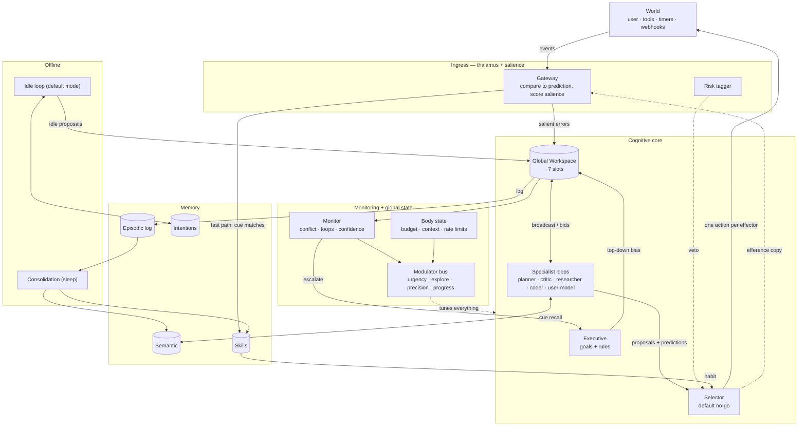
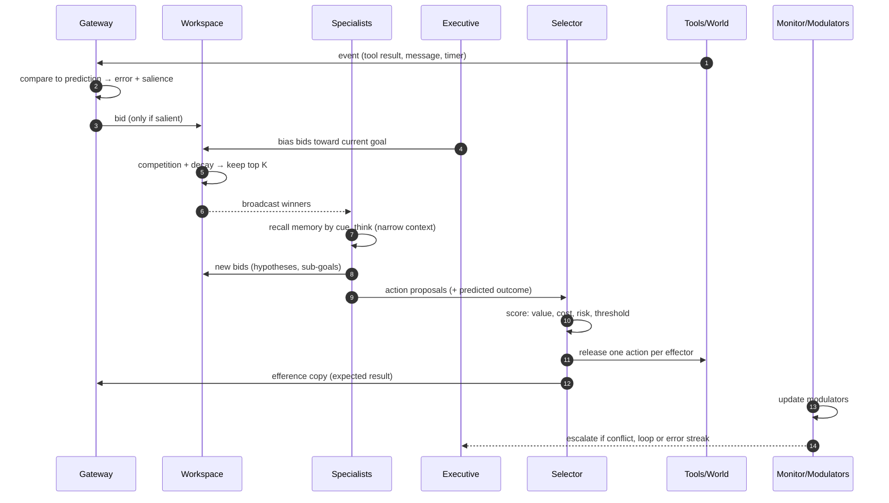
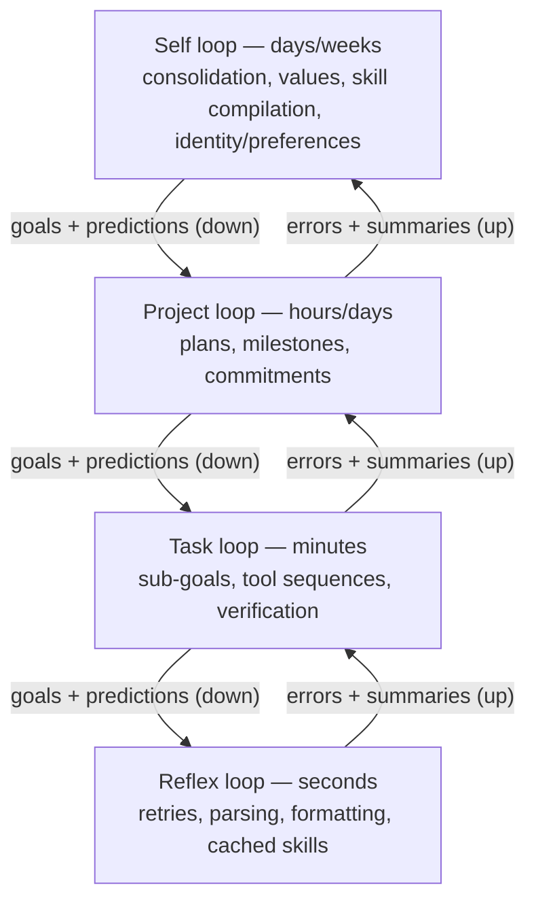
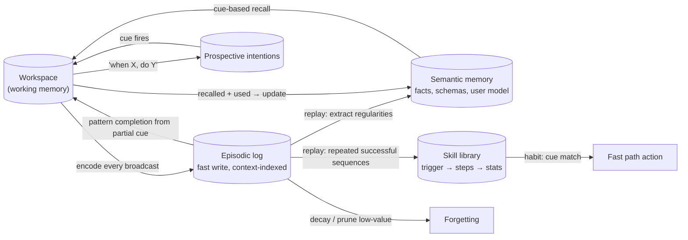
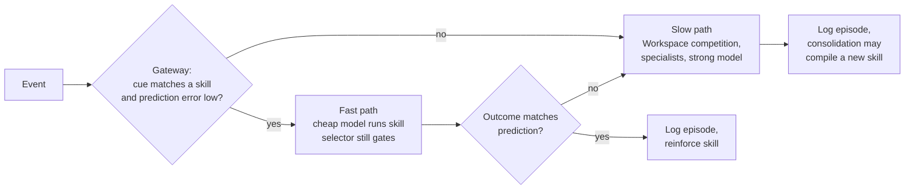

# A brain-inspired harness for LLM agent swarms

*Architecture sketch. Not built or benchmarked. Each module notes the brain principle it borrows; some of those principles (global workspace, predictive coding) are leading theories rather than settled science.*

## 0. Design stance

- **Borrow functions, not anatomy.** The brain isn't a blueprint; it's a set of proven answers to problems agents also have: limited attention, choosing one action among many, learning without forgetting, knowing when to think harder.
- **The LLM is the "cortical tissue."** A general pattern-completer that already holds a lot of semantic knowledge. What a bare agent loop lacks is everything *around* cortex: gating, action selection, memory systems, global modulation, offline learning. The harness supplies those.
- **A swarm should be a society of narrow loops coordinated by a small shared stage**, not N peers chatting in a group thread.

## 1. Principles → mechanisms

| Brain principle | Harness mechanism |
|---|---|
| Limited-capacity **global workspace** (conscious access) | A small shared **Workspace** (≈5–9 items). Specialists bid to get in; winners are broadcast to every loop. |
| **Predictive processing** | Every action carries a **predicted outcome** (efference copy). Only *prediction errors* propagate upward and grab attention. |
| **Thalamic gating** of input | An **Ingress Gateway** that filters, scores and routes incoming events against current goals and predictions. |
| **Basal ganglia** action selection (default inhibition, disinhibit the winner) | A **Selector** per effector. Default is *no-go*; one proposal is released at a time, scored by learned value, cost and risk. |
| **Prefrontal** executive control | An **Executive** holding the goal stack and task rules; biases which bids win (top-down attention). |
| **Anterior cingulate** conflict & error monitoring | A **Monitor** detecting disagreement, loops, low confidence and error streaks → escalates to slow mode or asks for help. |
| **Habit vs. goal-directed** control (dual process) | **Fast path**: cue → stored skill on a cheap model. **Slow path**: full deliberation through the Workspace on a strong model. |
| **Hippocampus + neocortex** (complementary learning systems) | Fast **episodic log** + slowly consolidated **semantic memory** + **skill library**. |
| **Sleep replay / consolidation** | Offline **Consolidation loop**: replays episodes, extracts schemas, compiles skills, prunes. |
| **Reconsolidation** | Memories are re-written (versioned) when retrieved and used. |
| **Neuromodulators** (dopamine, noradrenaline, acetylcholine, serotonin) | A **Modulator bus** of a few global scalars that tune model tier, thinking budget, parallelism, exploration. |
| **Interoception / allostasis** | A **Body-state** signal: budget, context pressure, rate limits, latency, error rates — anticipated, not just reacted to. |
| **Salience network** | An **Interrupt arbiter** deciding when new input pre-empts current work. |
| **Default mode network** | An **Idle loop**: prospection, reflection, checking pending intentions. |
| **Cortical timescale hierarchy** | Nested loops at different clock rates (seconds → weeks). |
| **Lateral inhibition** | Competing hypotheses/bids suppress each other; global inhibition prevents broadcast storms. |
| **Amygdala fast path** | A cheap **Risk tagger** that can pause an action before slow deliberation finishes. |

## 2. The overall architecture



**Reading it:** events enter through a gate that already knows what it expected. Surprising or goal-relevant things compete for a tiny shared stage. Whatever wins is broadcast, specialists react, propose actions, and a selector releases exactly one per effector — with a prediction attached so the next event can be scored. Everything that reaches the stage is logged; offline loops turn logs into knowledge and skills.

## 3. One cognitive cycle (a "tick")



Ticks are event-driven, not a fixed clock. A routine tool result that matches its prediction barely touches the Workspace; a surprise triggers a full cycle.

## 4. A hierarchy of loops at different timescales



- Higher loops send **expectations**, lower loops send back **only what deviated** — predictive coding as a communication protocol. That keeps context small: a project loop never sees a successful retry.
- Each level is its own agentic loop with its own context, model tier and clock. Swarm members live *inside* a level, not as a flat mesh.

## 5. Memory systems



| Store | Brain analogue | Write speed | Contents | Indexed by |
|---|---|---|---|---|
| Workspace | Working memory / conscious access | Every tick | Current focus only | Salience |
| Episodic log | Hippocampus | Immediate, append-only | What happened, in what context, how it turned out | Time, goal, entities, outcome valence |
| Semantic | Neocortex | Slow (consolidation) | Facts, schemas, models of users and systems | Concept / embedding |
| Skills | Basal ganglia / cerebellum (habits, procedures) | Slow, from repetition | Trigger, steps, preconditions, success rate, cost | Cue pattern |
| Prospective | PFC + hippocampus | On commitment | Future intentions | Trigger cue or time |

Two brain properties worth keeping explicitly:

- **Fast and slow stores stay separate**, so new episodes don't overwrite established knowledge (the complementary-learning-systems argument).
- **Recall is reconstruction.** Retrieval returns a cue-completed sketch with provenance, and using a memory re-writes it (versioned). Treat recalled content as a hypothesis, not ground truth.

## 6. Component details

### Workspace
- Fixed capacity (K items or a token budget). Each item: `content, source, salience, provenance, ttl`.
- Bid score ≈ `prediction error × goal relevance × precision + urgency`, with decay each tick and lateral inhibition between items that contradict.
- Broadcast goes only to loops whose **subscriptions** match (sparse activation), so cost scales with relevance, not swarm size.

### Specialist loops
- Narrow role, narrow context: they see the broadcast plus their own private scratch state, never the whole history.
- Examples: planner, critic/verifier, researcher, coder, memory retriever, **user model** (theory of mind: what does the human want, know, expect), risk assessor.
- Output only two things: Workspace bids and action proposals with predictions.

### Selector (action gating)
- Default **no-go**. A proposal must clear a threshold set by value estimate, cost, risk and current modulators.
- One in-flight action per effector; brief **refractory period** after an action so the same proposal can't fire repeatedly.
- Value estimates are learned per (context type, action type) from outcomes — reward prediction error updates them.

### Monitor (metacognition)
- Inputs: specialist disagreement, repeated near-identical actions, streaks of prediction error, low or spread-out confidence, stalled progress.
- Outputs: escalate to slow path / stronger model, more thinking budget, switch strategy, spawn a critic, or **ask the human**.

### Modulator bus

| Signal | Rough analogue | Computed from | Turns up / down |
|---|---|---|---|
| **Urgency** | Noradrenaline (arousal) | Deadlines, user waiting, interrupt salience | Parallelism, speed tier, interrupt threshold |
| **Explore** | Noradrenaline (tonic) / dopamine | Stalled progress, repeated errors, novelty | Temperature, number of alternative proposals, trying unused skills |
| **Precision** | Acetylcholine | Reliability of recent inputs vs. stored priors | How much to trust new evidence vs. memory/plans |
| **Progress** | Dopamine (reward prediction error) | Outcome vs. expected outcome | Skill/value updates, persistence vs. giving up |
| **Patience** | Serotonin (debated) | Budget headroom, task horizon | Willingness to wait for delayed payoff |

These are global, cheap scalars — a way to change the *whole system's mode* without rewriting any loop's prompt.

### Body state
- Budget remaining, tokens per context, rate-limit headroom, latency, error rates, queue depth.
- **Allostatic**: forecast needs (e.g., consolidate before context fills; downshift model tier before budget runs out) rather than react at the limit.

### Offline loops
- **Consolidation ("sleep")** — runs when idle or on a schedule: replay recent episodes, merge duplicates, extract schemas and user-model updates, compile repeated successful sequences into skills, decay low-value memories, recalibrate value estimates.
- **Idle loop ("default mode")** — simulate likely next requests, pre-fetch context, check prospective intentions, reflect on open threads. Gets out of the way the moment the interrupt arbiter fires.

## 7. Two paths through the same system



Over time, work migrates from slow to fast as skills are compiled — and migrates back the instant a skill's prediction fails.

## 8. Interface sketch

```ts
type Prediction = { expect: string; confidence: number; checkBy?: Date };

type Bid = {
  content: string; source: LoopId; salience: number;
  provenance: Ref[]; ttlTicks: number; contradicts?: BidId[];
};

type Proposal = {
  effector: string; action: ToolCall; predicted: Prediction;
  estValue: number; estCost: number; risk: 'low' | 'med' | 'high';
};

type Modulators = { urgency: number; explore: number; precision: number; progress: number; patience: number };

interface Loop {
  id: LoopId; level: 'reflex' | 'task' | 'project' | 'self';
  subscribes(item: Bid): boolean;          // sparse activation
  onBroadcast(items: Bid[], mods: Modulators): Promise<{ bids: Bid[]; proposals: Proposal[] }>;
}

type Episode = {
  at: Date; goal: string; context: Ref[]; action?: Proposal;
  outcome: string; predictionError: number; valence: number;
};

type Skill = {
  trigger: CuePattern; steps: Step[]; preconditions: string[];
  successRate: number; avgCost: number; uses: number; lastFailure?: Date;
};
```

## 9. Failure modes, with brain analogues

| Failure | Brain analogue | Guard |
|---|---|---|
| Repeating the same failing action | Perseveration | Monitor loop detection, selector refractory period, explore↑ |
| Confident fabrication | Confabulation | Provenance on every Workspace item; "source monitoring" check before acting |
| Drifting onto shiny side-quests | Attention capture | Executive goal bias, salience caps per source |
| Loops triggering each other endlessly | Seizure / runaway excitation | Global inhibition: per-tick bid budget, broadcast rate limits |
| New lessons overwrite old ones | Catastrophic interference | Separate fast episodic and slow semantic stores |
| Memories drift into falsehood | False memory via reconsolidation | Versioned rewrites, keep original episode immutable |
| Habits firing in the wrong context | Action slips | Skill preconditions + prediction check on every fast-path action |

## 10. Where the analogy breaks

- **Cost model is inverted.** Brain parallelism is nearly free and continuous; every LLM "neuron firing" is a paid, discrete call. Broadcasts and parallel specialists must be rationed — sparse activation isn't optional.
- **No online synaptic learning.** Model weights are fixed at runtime, so "learning" lives in memory stores, skills, value tables, prompts — or offline fine-tuning.
- **Context window ≠ working memory.** It's far larger but degrades less gracefully; the Workspace limit is a design choice, not a biological necessity.
- **One LLM already contains a lot of what the brain spreads across modules.** Splitting into specialists can lose coherence that a single strong call would have kept.
- **The theories are uneven.** Complementary learning systems and basal-ganglia action selection are well supported; global workspace and predictive processing are influential but contested.

## 11. Prior art worth reading

- **Global Workspace Theory** (Baars) and **LIDA** (Franklin) — cognitive-cycle architecture built on it.
- **SOAR** and **ACT-R** — classic cognitive architectures with explicit working, declarative and procedural memory.
- **CoALA** (Sumers et al., 2023) — "Cognitive Architectures for Language Agents" framework.
- **Generative Agents** (Park et al., 2023) — memory stream, reflection, planning.
- **MemGPT / Letta** — tiered memory paging for LLMs.
- **Voyager** (2023) — growing skill library from experience.
- **Reflexion** (2023) — verbal self-reflection from failures.

## 12. A sensible build order

1. **Episodic log + consolidation into semantic memory and skills.** Highest leverage, least coupling.
2. **Predictions on every action + error-driven escalation** (fast/slow paths, Monitor).
3. **Modulator bus and body state** driving model tier, thinking budget and parallelism.
4. **Workspace + specialist loops** — the most "brain-like" piece, and the one most likely to cost more than it returns; add it last and only where a single loop measurably fails.
5. **Loop hierarchy** for long-running work.

At each step, compare against a single-loop baseline on matched real tasks: success rate, cost, latency (including tails), and how often a human had to intervene.
